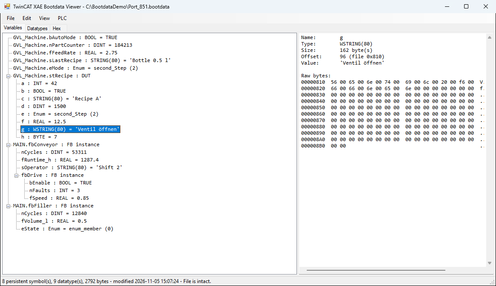
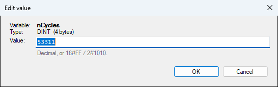
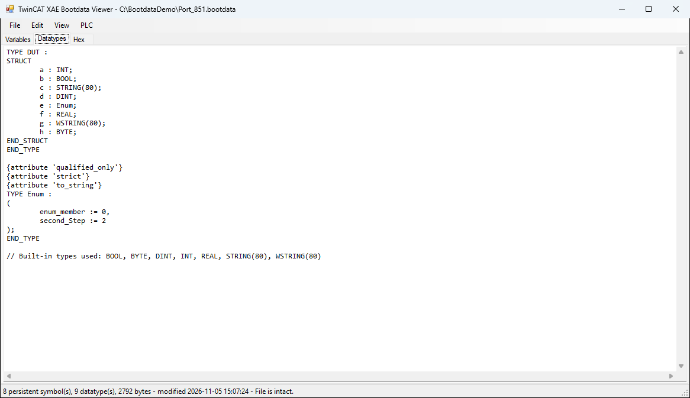
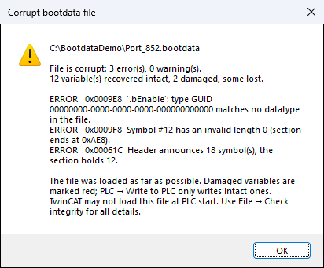
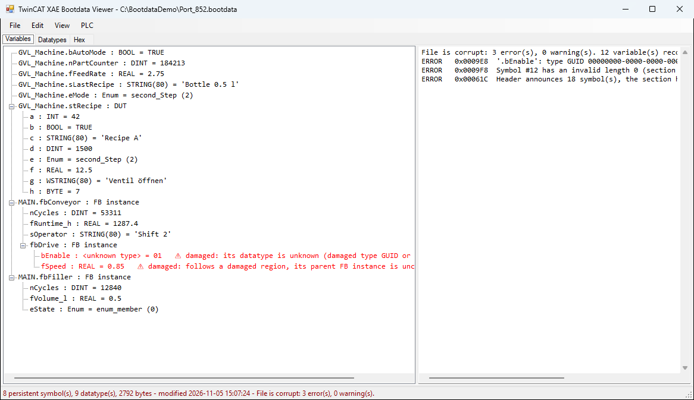

# TwinCAT XAE Bootdata Viewer

View, check, edit and restore TwinCAT 3 persistent data (`Port_xxx.bootdata`) - standalone or
right from TwinCAT XAE (TcXaeShell, Visual Studio 2022/2026).

When a PLC loses its persistent values (new download, replaced hardware, a corrupt file after a
power failure), the last good values are often still in a bootdata file. This tool shows them by
name and type and writes them back into the running PLC by symbol name.



## Features

- **Viewer** - opens `Port_xxx.bootdata` / `.bootdata-old` files of TwinCAT 3.1 (4026) and shows every
  persistent variable with its datatype and value: structs, arrays, FB instances, enums, strings,
  times/dates and BIT members. A *Datatypes* tab lists the embedded types as ST declarations, a *Hex*
  tab shows the raw file.
- **Edit and save** - change values with type-aware input (validated, e.g. range checks, `T#1h30m`,
  `DT#...`, enum names); only the value bytes are patched, everything else stays byte-for-byte the same.
- **Integrity check** - detects truncated, zero-filled or damaged files and implausible values
  (BOOL = 5, enum values that are no member, strings without terminator, NaN).
- **Recovery** - loads damaged files as far as possible; intact variables can still be used,
  damaged ones are marked red and never written.
- **Open from target** - reads the bootdata file of any target (Windows, TwinCAT/BSD, UmRT) over ADS
  (read only), using the routes of the local TwinCAT system service.
- **Compare / write to PLC** - compares the file with the running PLC side by side (differences
  highlighted, structs expandable) and writes the selected variables by symbol name, only while the
  PLC is in Run and after confirmation. Warns if the PLC program has no `FB_S_UPS` or
  `FB_WritePersistentData` instance.
- **TwinCAT XAE integration** - menu **TwinCAT > Bootdata** opens the bootdata of the selected PLC from
  the active target, compares/writes it, and `.bootdata` files open in the viewer.
- **Command line** - dump, JSON export, integrity check and scripted compare/write.

## Screenshots

| Edit a value | Embedded datatypes as ST |
|---|---|
|  |  |

| Damaged file detected | Intact values recovered, damaged ones marked red |
|---|---|
|  |  |

The screenshots use a made-up demo file.

## Installation

### With TcPkg (recommended)

The packages are signed. Trust the certificate once (as administrator), add the folder with the
`.nupkg` files as a source and install the main package; TcPkg adds the integration for each IDE it
is configured for (`UseTcXaeShell64`, `UseVS2022`, `UseVS2026`):

```bat
tcpkg certificate add TcPkg\BootdataViewer-signing.cer
tcpkg source add -n "BootdataViewer Local" -s <folder with the .nupkg files>
tcpkg install TwinCAT.XAE.BootdataViewer
```

| Package | Content |
|---|---|
| `TwinCAT.XAE.BootdataViewer` | main package (workload); selects the IDE packages below |
| `TwinCAT.XAE.BootdataViewer.TcXaeShell64` | extension + viewer for TwinCAT XAE Shell (64-bit) |
| `TwinCAT.XAE.BootdataViewer.VS2022` | extension + viewer for Visual Studio 2022 |
| `TwinCAT.XAE.BootdataViewer.VS2026` | extension + viewer for Visual Studio 2026 |

The extension is installed to `<IDE>\Common7\IDE\Extensions\BootdataViewer\BootdataViewer`; the viewer
lives in its `Viewer` subfolder and gets the Start menu entry *TwinCAT XAE Bootdata Viewer*.

## Usage

### In TwinCAT XAE

| Menu | Action |
|---|---|
| TwinCAT > Bootdata > Open Bootdata of Active PLC | reads `Port_<port>.bootdata` of the selected PLC from the active target |
| TwinCAT > Bootdata > Open Previous Bootdata (-old) | the same for `Port_<port>.bootdata-old` |
| TwinCAT > Bootdata > Compare / Write Bootdata to Active PLC... | opens the file and the compare/write window for that PLC |
| TwinCAT > Bootdata > Bootdata Viewer... | starts the viewer without a file |

The same entries are on the context menu of TwinCAT and PLC projects. The active target is taken
from TwinCAT XAE (Automation Interface), the PLC port from the project (`AmsPort`).

### Viewer

- **File > Open** (Ctrl+O), drag and drop, or **File > Open from target...** (Ctrl+T)
- **Edit > Edit value** (F2, double-click, Enter) - **File > Save** (Ctrl+S) keeps the previous file as `.bak`
- **File > Check integrity...** (Ctrl+I)
- **PLC > Write to PLC...** (Ctrl+W)

> Save a file in a TwinCAT boot folder only while that runtime is in Config mode: TwinCAT overwrites it
> when the PLC stops and reads it when the PLC starts.

### Command line

```text
BootdataViewer.exe [<file>]                              GUI
BootdataViewer.exe --target <AmsNetId> [--port <n>] [--old] [--write-dialog]
                                                         GUI, file read from the target
BootdataViewer.exe --dump  <file>                        text tree
BootdataViewer.exe --json  <file>                        JSON
BootdataViewer.exe --types <file>                        embedded datatypes as ST
BootdataViewer.exe --check <file>                        integrity check (exit 0 intact, 1 warnings, 2 corrupt)
BootdataViewer.exe --write <file> [--target <AmsNetId>|local] [--port <n>] [--filter <prefix>] [--yes]
                                                         compare with the PLC; --yes writes the differing values
```

`--write` without `--yes` is a dry run.

## Building

Requirements: .NET SDK (8 or newer, for building), Visual Studio 2022 with the *Visual Studio extension development*
workload, TwinCAT 3.1 4026 with TcPkg (for packaging).

```powershell
.\TcPkg\build.ps1                                   # viewer, VSIX and packages (unsigned)
.\TcPkg\build.ps1 -Thumbprint <cert thumbprint>     # signed with a certificate from the user store
.\TcPkg\build.ps1 -Pfx cert.pfx -Password <pw>      # signed with a PFX file
```

Output: `TcPkg\out\*.nupkg`. The version is taken from
`BootdataViewer.VsExtension\source.extension.vsixmanifest`. The package icon is drawn by
`TcPkg\icon\make-icon.ps1`.

| Folder | Content |
|---|---|
| `BootdataViewer` | viewer and command line tool (WinForms, .NET Framework 4.8.1) |
| `BootdataViewer.VsExtension` | VSIX for VS 2022/2026 and TcXaeShell; starts the bundled viewer out of process |
| `TcPkg` | nuspecs, install scripts (`shared`), build script, icon, public signing certificate |

## Bootdata file format

The format is not documented by Beckhoff; it was reverse-engineered from TwinCAT 3.1 (4026) files:

```text
"TC3="  u32 typeCount  u32 typeSectionSize
AdsDatatypeEntry[typeCount]            standard ADS datatype entries (self-sized)
u32 symbolCount  u32 symbolSectionSize
SymbolEntry[symbolCount]:
    u32 entryLength, u32 size, u16 flags, u16 nameLength, name\0,
    padding to 4 bytes, data[size], padding, type GUID (last 16 bytes; value entries only)
```

The symbol table is a flattened tree: the low byte of `flags` is the nesting depth, `0x8000` marks an
FB instance (container without data), `0x4000` an entry with a value. Nested names start with `.`
(members) or `[` (array elements), e.g. `MAIN.aAxes[1].nCycles`. The file has no checksum, so a
changed byte inside a value cannot be detected - only structural damage and impossible values.

## Notes

- Writing into a PLC changes a running machine. Check the values before you write them.
- Tested with TwinCAT 3.1 4026, TcXaeShell 64-bit and Visual Studio 2022. Visual Studio 2026 support
  follows the same mechanism but is untested.

TwinCAT and Beckhoff are trademarks of Beckhoff Automation GmbH & Co. KG. This project is not
affiliated with or endorsed by Beckhoff.
